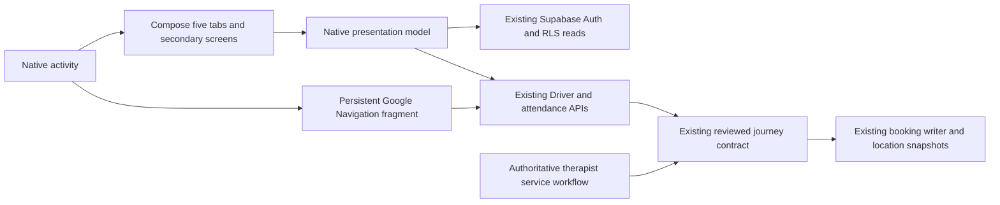

# Native Driver Compose — local verification handoff, 2026-11-17

**LOCAL EMULATOR UI PASS; RELEASE CORRECTION REQUIRED.** A dedicated native Kotlin/Compose application now implements the five supplied reference screens. No WebView is constructed. Local verification is complete for the scope recorded below. Connected backend/business acceptance, phone performance, real GPS/voice/QR/push and independent external review remain open. The owner explicitly requested local emulator verification first.

## Authorization and exact source

- Branch: `stage/driver-native-compose-20261117`.
- Worktree: `E:/cradlehub/.worktrees/driver-native-compose`.
- Freshly fetched accepted `origin/main`, local main and merge base: `51ba200580068691a0358323e00c8c4a7a8de11e`.
- Implementation baseline: preceding local unified candidate `1e23e92f4e146d0448f9f7e58b575d284511eade`.
- Native implementation head: `5ae93d7a9a21f5753d5e99e7a208fa7ad663b38a` (23 native files; [exact implementation manifest](driver-native-compose-2026-11-17/implementation-files.txt)). The subsequent closeout commit contains only this evidence/governance. Resolve its exact HEAD with `git rev-parse stage/driver-native-compose-20261117`.
- Current owner brief: attached “NATIVE ANDROID UI IMPLEMENTATION & COMPLETE DRIVER WORKFLOW”, plus “Finish local emulator verification first”. This supersedes the earlier four-tab hybrid design. Separate native experiments and existing USB-preview changes were inspected and preserved; they were not overwritten or adopted blindly.
- New changes are confined to `native/driver-android`, active governance and this report/evidence. **No Web/PWA/API/SQL/schema/package-lock source changed relative to the preceding candidate.** No main merge, push, deployment, production access, persistent runtime activation, staff APK distribution or real notification occurred.

The existing attendance rule is preserved: one scan up to 120 minutes before shift start records arrival; credited working time begins at scheduled shift start; no second scan. This UI slice installs no attendance policy or migration.

## Native architecture and workflow

`NativeDriverActivity` is the single AppCompat/Compose host. It retains one embedded Google `NavigationFragment`/controller across ordinary tab changes. Native screen composition owns Today, Trips, Scan, Map and More, with a raised Scan control. The two old activity names are compatibility subclasses only. The old PWA remains untouched.

`NativeDriverModel` retains presentation state, refreshes authorized snapshots and rejects incompatible trip switches while guidance/events are active. `NativeDriverBackend` uses existing password Auth/refresh/user verification and RLS reads; encrypted AndroidKeyStore-backed preferences store session/cookies, never passwords or local booking authority. Existing cookie-authenticated APIs receive the installed Supabase SSR cookie wire format, tested for UTF-8/chunking/header injection. Runtime/build guards reject privileged keys and known production hosts. Default builds are inert until explicitly configured for TEST. OAuth-only sign-in needs a separately reviewed system-browser/PKCE flow.

Tap an assigned trip → Map directly → resolve the current authorized leg → one explicit Start. No intermediate preview or details modal. Trip details are optional on Map. End route stops SDK guidance only; it does not complete transport, service or attendance. SDK terms/attribution and safety UI remain SDK-owned. Recenter checks permission again inside its asynchronous callback and catches permission removal.

The preserved transport sequence is branch pickup → explicit therapist boarding → customer delivery → therapist service → driver leaves → service completion/readiness → driver returns for collection → explicit therapist collection → branch return → explicit drop-off. GPS arrival cannot establish boarding. The server still owns assignment, staff/branch identity, stage/leg, compare-and-swap revisions and idempotent request checks. Native GPS uses the reviewed accuracy/freshness/geofence rules and existing CRM location writer. No competing location store was added. Process recovery revalidates authority; a lost SDK guidance session requires explicit Resume.

CameraX provides native lifecycle-bound preview/analysis with latest-frame backpressure, bundled QR-only ML Kit, bounded one-in-flight decoding and frame cleanup. Trusted HTTPS QR origin/path validation precedes the existing server attendance endpoint. Transport uncertainty retains the request identity for retry; client GPS never substitutes for attendance authority. Real QR decoding/submission remains a phone/connected TEST gate.

More provides native My Profile, Attendance & Shift, Trip History, Notifications, Support and Logout. Profile/branch/avatar are authorized data or initials, never the reference photo. Trip History distinguishes service completion from unverified collection/return. Failures show unavailable states instead of falsely empty data. Support uses only the configured branch phone. FCM preserves the reviewed token/device contract; no Firebase configuration or actual delivery was used. The newer Installation-ID SDK contract requires separate backend review.

## Actual native screenshots

All captures are from the compiled app on the disposable emulator, with a visible **UI TEST** brand and clearly synthetic customers. They are native screens, not PNG backgrounds or browser mockups. The emulator camera shows its virtual room. The Map capture deliberately shows the real disconnected authority error and Retry, with no fabricated route, turn, ETA or Start authorization.

| Screen | Capture |
| --- | --- |
| Today | [Native Today](driver-native-compose-2026-11-17/01-today.png) |
| Trips | [Native Trips](driver-native-compose-2026-11-17/02-trips.png) |
| Scan | [Native camera preview](driver-native-compose-2026-11-17/03-scan.png) |
| Map | [Native SDK pane / authority unavailable](driver-native-compose-2026-11-17/04-map.png) |
| More | [Native More](driver-native-compose-2026-11-17/05-more.png) |
| Accessibility/recovery | [130% font More](driver-native-compose-2026-11-17/06-more-font130.png), [camera denied](driver-native-compose-2026-11-17/07-camera-denied.png) |

Forest/cream/gold tokens are taken from the existing Staff profile foundation. Native canvas icons/leaf shapes, actual data-driven avatar/initials, cards, filters and controls implement the references. Font-size and permission recovery captures were visually inspected. TalkBack, landscape/tablet and full WCAG/device acceptance were not certified.

## Verification actually run

LOCAL target: new disposable E-drive AVD `CradleDriverCompose`, serial `emulator-5580`, Android 17/API 37 Google APIs/Play x86_64, software graphics, 2GB RAM/two vCPU, display 864×1824 at density352 (approximately 393×829dp). Existing AVD data was not wiped or moved. The new emulator was stopped after evidence capture. No physical phone is attached. First boot had a System UI dialog and an emulator radio-service crash; application acceptance is not inferred from emulator boot health.

| Check | Result and boundary |
| --- | --- |
| JVM unit tests | **33/33 pass:** nine retained session-state tests plus 24 native model/policy/QR/SSR/target-guard tests. [Summary](driver-native-compose-2026-11-17/unit-results.json). |
| Instrumentation | **6/6 pass** on final native build, 21.481s: native five tabs/More/Profile, direct trip→Map, filters, no browser view in native hierarchy, encrypted session read/clear, Scan/permission recovery. [Transcript](driver-native-compose-2026-11-17/compose-instrumentation-final.log). |
| Builds | Debug app/test APKs plus normal release Kotlin/Java compilation pass. Release fixture flag defaults false; fixture source exists only under debug. [Build log](driver-native-compose-2026-11-17/compose-validation-final.log), [APK digests](driver-native-compose-2026-11-17/apk-digests.json). No release distribution artifact was created. |
| Lint | Pass, **0 errors / 38 warnings**, no baseline or error suppression added to conceal permission failures. Warnings include dependency currency, unused legacy XML, modifier conventions, backup extraction guidance and KTX suggestions. Gradle future-version deprecations remain. |
| Config rejection | Offline configuration rejects a synthetic `sb_secret_` key and the known production hostname before packaging. [Key guard](driver-native-compose-2026-11-17/native-secret-guard.txt), [production guard](driver-native-compose-2026-11-17/native-production-guard.txt). No production request occurs. |
| Source/scope | `git diff --check` passes; no browser import/construction in main native source; no Web/API/SQL source difference from implementation baseline. Fetched `origin/main` remains the accepted SHA above. |
| Connected workflow | **NOT RUN**: TEST API/project/key/phone not identified. No sign-in/refresh/logout/backend mutation, live GPS/guidance/voice, QR submission, FCM, CRM synchronization or background-guidance proof is claimed. |
| Prior database evidence | Earlier unchanged manifest passed 22 disposable LOCAL TEST scenarios and cleanup. It was not rerun or installed here; it does not establish Supabase runtime parity. |

Reproduction uses the fixture Gradle command in [native README](../../native/driver-android/README.md), with tasks `testDebugUnitTest assembleDebug assembleDebugAndroidTest lintDebug compileReleaseKotlin compileReleaseJavaWithJavac`. JBR21/Gradle9.6.0/AGP9.0.1/Compose compiler2.2.10 were used. Espresso was updated to3.7.0 after the old test runner hit the documented API37 InputManager reflection incompatibility; the six tests then passed. Google Navigation remains8.1.0; CameraX1.4.2/bundled barcode17.3.0. No production credentials were copied.

## Measured local performance and limitations

These are development fixture/emulator measurements, **not phone acceptance or an improvement claim**. No network trip-loading latency can be inferred from synthetic data. No JVM/Gradle build was intentionally running during the final cold series.

| Measurement | Raw evidence |
| --- | --- |
| Earlier Compose cold process launches before lazy SDK pane initialization | `am start -W` TotalTime4396 /4900 /6211ms. [Baseline](driver-native-compose-2026-11-17/compose-before-cold.txt). |
| Final cold process series | First `am start -W` **timed out**, WaitTime20822ms; next successful TotalTime5154 /4575ms. [Final](driver-native-compose-2026-11-17/compose-after-cold.txt). No performance PASS is claimed. |
| Final Compose first-frame markers | 17812ms outlier, then4177 /3748ms. These markers start at the app instrumentation object's initialization, not an OS end-to-end clock. |
| Warm navigation interactions | Trips tab229ms; trip tap→native Map2541ms (SDK pane/authority error, **not route-ready**); Scan tab368ms; More tab212ms. |
| Native camera | First analyzed frame2545ms after entering Scan in the final warm sequence. The screenshot subsequently shows the virtual room; this is not a physical-camera QR decode result. |
| Fixture refresh | Warm local fixture load markers2 /5 /52 /42ms; some cold samples include main-thread scheduling/composition delay. Not backend timings. |
| Route-ready / Start-to-guidance | Unavailable because no connected authority or valid Navigation key; no zero/fabricated timings. |

[Final markers](driver-native-compose-2026-11-17/compose-final-metrics.txt) and [startup investigation](driver-native-compose-2026-11-17/compose-runtime-review.txt) are retained. No application exception or Android ANR explained the cold timeout (`dumpsys activity lastanr` returned none); its root cause is unresolved. SDK creation is deferred until a trip needs Map, then retained across ordinary tabs. Further device profiling and cold-start acceptance are required, rather than hiding the outlier or assuming emulator speed predicts driver phones.

## Remaining gates, external review and rollback

**External independent review: NOT COMPLETE.** Implementation inspection and emulator testing are not external acceptance. The review package is now concrete: exact source commit, file manifest, six instrumentation/33 unit results, screenshots, configuration guards and known issues. No reviewer identity/verdict is fabricated.

Next permitted work after local verification is review and identification of existing approved TEST resources plus the target phone, followed by separately scoped connected acceptance. That matrix must exercise native auth/session refresh/revocation/logout, denied/revoked camera/location/notification permissions, duplicate/lost-response QR retry, trip reassignment/cancellation, offline recovery, process death, active-guidance tab/background/resume, real GPS/voice/reroute, the separate pickup/delivery/service/collection/return workflow, device opt-out/revocation and CRM two-session parity. Native code alone does not install the preceding journey contracts.

The existing pilot packaging workflow has not been updated to inject native TEST configuration. It is not an authorized distribution path for this candidate; packaging guards intentionally block missing/mismatched TEST inputs. Keep the synthetic fixture APK away from staff.

No production rollback is needed because nothing was deployed, merged, activated or distributed. To abandon the candidate, park this branch and retain the accepted app/PWA. A later authorized installation rollback must restore the previously accepted signed package under its own release procedure. Do not delete unrelated worktrees or change SQL/production controls as part of rollback.

## Owner phone installation follow-up — 2026-11-17

The owner explicitly requested installing the app on their connected Android phone to test it. This narrowly authorizes the personal test installation after the earlier emulator-only instruction; it does not authorize general staff distribution, backend activation or production work.

The recorded debug APK SHA-256 `4b9522cb30f1939a6001edb42ad5a6657339332aab4125fdd01ec7d98e8f4d36` matched the artifact. Android apksigner verification passed. ADB installed the separate `com.mpgtechnologies.cradlehub.driver.localtest` package successfully on RMX3081 / Android13 / API33, version `0.3.0-native-compose-review-local-test`. No earlier copy of this test package was detected; no app was uninstalled and no existing production app/session was replaced. Native activity launch returned Status ok, cold TotalTime4577ms / WaitTime4616ms, and the package's NativeDriverActivity was confirmed top-resumed. This is one phone launch measurement, not performance certification.

The app was left open for the owner. It still uses the explicit synthetic UI TEST fixture, inert backend target and invalid Navigation key. No live sign-in, attendance submission, guidance, GPS, push or CRM operation was performed. Camera and other runtime permission decisions remain with the owner. Physical hardware is now available for owner UI testing; connected workflow acceptance and external review remain open. No phone screenshot or private phone content was collected. Main, production and deployment remain unchanged.
