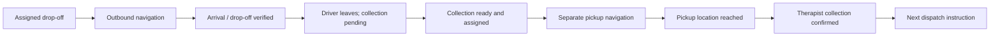
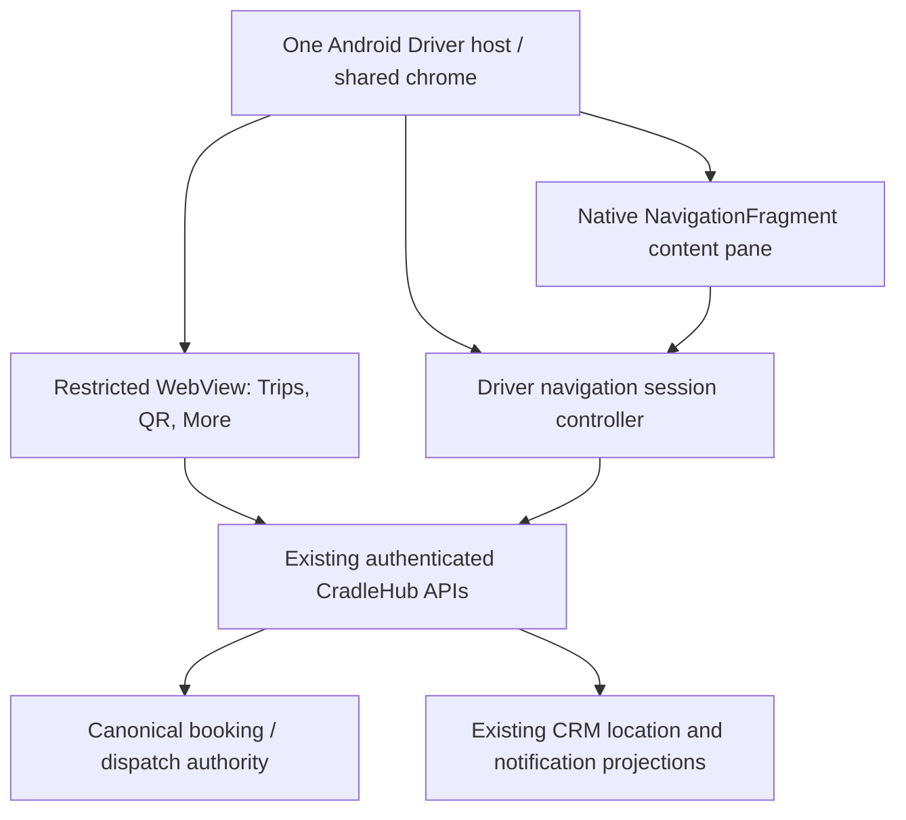

# Driver portal and native navigation review

Date: 2026-11-16. Disposition: **INVESTIGATION COMPLETE / IMPLEMENTATION PROPOSED**.
No application, Android, database or production configuration was changed.

## Owner request and boundaries

The owner asked to retrieve missing remote work, inspect the existing Driver
portal/native navigator and decide how to build a properly integrated experience.
The owner clarified: **the driver drops the therapist off, leaves, then returns
to collect the therapist**. A single outbound customer route is insufficient.

- Review branch: `stage/driver-portal-navigation-review-20261116`.
- Worktree: `E:/cradlehub/.worktrees/driver-portal-navigation-review`.
- Baseline local main: `51ba200580068691a0358323e00c8c4a7a8de11e`, including the
  separately accepted local Attendance merge. Main was preserved.
- Fetched remote main: `6c5380e96290edd93077b1c6a318e537f89453e3`; only remote
  `refs/heads/main` was advertised. No missing remote driver branch was found.
- Separate local driver work at `c60f5341` was inspected, not integrated. Its
  six-file difference contains USB/debug-origin support and a matching contract
  test, not a replacement native shell or collection model. Preserve it and
  deliberately adapt useful pieces after reconciling current pilot settings.
- No push, merge, deployment, production query, booking/attendance mutation,
  paid Maps request, device installation or APK distribution occurred.

## What already exists

| Layer | Actual source | Present behavior |
| --- | --- | --- |
| Canonical portal | `src/app/(dashboard)/staff/layout.tsx` and `src/components/features/staff-portal/driver/driver-mobile-shell.tsx` | Role-aware Driver shell, retained Web tabs and Trips / QR Scanner / Navigation / More. |
| Trips | `src/components/features/staff-pwa/driver/driver-native-home.tsx`, `driver-trip-row.tsx`, `driver-native-trips.tsx` | Primary assignment, later jobs, history and deep links into native navigation. |
| Web route | `src/app/(dashboard)/staff/driver/map/page.tsx` and `driver-focused-trip-route.tsx` | Authorizes selected booking and renders a single-trip Web map; older combined route remains behind `view=combined`. |
| Android host | `native/driver-android/app/src/main/java/com/mpgtechnologies/cradlehub/driver/DriverShellActivity.java` | Restricted authenticated WebView; intercepts allowed native-launch links and starts a separate activity. |
| Native guidance | `NativeNavigationActivity.java` and `res/layout/activity_navigation.xml` in the same Android source tree | Google Navigation SDK 8.1.0, route preparation, explicit Start, voice guidance/rerouting and local SDK arrival callback. |
| Authorized APIs | `src/app/api/staff/driver/native-itinerary/route.ts` and `native-start/route.ts` | Recheck driver identity, assigned confirmed trip and destination; Start reuses the established server booking-progress command. |
| Native notifications | `DriverMessagingService.java` | Receiver and generic booking-ID deep link. Token registration and sender are explicitly not implemented. |
| Distribution | `native/driver-android/PILOT-INSTALLATION.md` | Separate TEST pilot package/runbook; it is not proof of a working installed fleet. |

Keep these foundations. A rewrite into a new web framework or a second backend
is unnecessary for the integration problem identified here.

## Confirmed source gaps and evidence limits

1. **The portal shell disappears during guidance.** `activity_driver_shell.xml`
   contains only a WebView. `DriverShellActivity.java:144` calls
   `startActivity(nativeRoute)`. The destination layout is a full-screen
   NavigationFragment with status/Start overlays, without the portal tabs or
   job context. This is a source-confirmed structural split, not a real-device
   screenshot observation.
2. **Transport work is conflated with service progress.** The current
   `RealDispatchItem` is projected from booking progress; `driver-ui-model.ts`
   treats booking completion/cancellation as trip closure. Its driver actions
   only start travel and mark arrival. No explicit collection leg was found in
   the reviewed driver/query/API/native paths. Service completion can therefore
   remove work from the driver projection without proving therapist collection.
3. **Native arrival and server state are disconnected.** The SDK listener in
   `NativeNavigationActivity.java:179` stops guidance and displays Arrived. It
   deliberately sends no authorized arrival/collection command. Do not relabel
   this local signal as a recorded CradleHub event.
4. **Native guidance does not supply the CRM location writer.** The Web component
   posts its existing guarded snapshot only while visible. The Android navigator
   has no corresponding authenticated upload path in the reviewed source.
   Background native guidance is not proof of CRM tracking.
5. **Navigation state has no complete shell restoration contract.** The Web host
   saves WebView state, while active booking hints and native route/guidance
   booleans are activity fields. No explicit native onResume reconciliation or
   ongoing reassignment/cancellation refresh was found. Rotation, process death,
   Back and stale selection require device verification and deliberate design.
6. **QR Scanner is exposed without native camera wiring in this source.** The
   manifest has no CAMERA permission and the WebChromeClient handles geolocation,
   not WebView `onPermissionRequest` camera grants. Verify/fix this before calling
   the existing PWA scanner functional inside the APK. No physical camera was
   tested in this review.
7. **Native push is a receiver foundation.** `onNewToken` is intentionally empty;
   do not infer delivery from the presence of FirebaseMessagingService or from
   Web Push subscriptions. Registration, ownership, revocation, sender and
   receipt/tap acceptance remain necessary.
8. **Multiple route implementations obscure the implementation target.** The
   canonical map page uses DriverFocusedTripRoute. DriverNativeMap and legacy
   routes remain in the tree; changing an old presentation alone will not fix
   the active Android shell.

The itinerary/Start authorization is useful and must be preserved. This review
made no live Supabase verification. `lsrbwqhvzjfpiabeolkv` remains the known
PRODUCTION project and was not contacted. No Android device was connected via
ADB; no claim about an installed APK or actual driving behavior is made.

## Recommended experience

Preserve the four canonical destinations: **Trips, QR Scanner, Navigation, More**.
Give them consistent weight rather than a visually dominant floating QR action.
Keep one obvious next action for each transport leg, a compact active-trip banner
when outside Navigation, and a clear route sheet showing destination, provider,
ETA freshness and dispatch help. The native map must occupy the same app shell.

The owner-confirmed journey should be represented as:

Service progress runs alongside this transport state. Customer service
completion must not automatically mean driver arrival, therapist collection,
return to branch, or attendance clock-out. A GPS arrival observation is not
proof that the therapist boarded the vehicle. Collection should remain visible
even if the service booking is completed. The preview demonstrates these
separations using synthetic data only.

Before implementing the collection contract, settle who declares readiness
(provider or CRM), how service extensions revise estimates, whether collection
may be reassigned to a different driver, and where the driver goes after pickup.
The prototype uses an explicit simulated readiness event; it does not establish
these policies. Preserve the accepted arrival policy until its authorized
server-evidence contract is agreed, rather than silently introducing mandatory
manual arrival or trusting every GPS callback.

## Recommended architecture

Use one host activity with a WebView and native navigation content pane. The
Android host owns its navigation chrome; the browser PWA retains its current
Web chrome. Suppress duplicate Web chrome inside the native host using a
presentation-only host capability, never a User-Agent authorization rule.
Keep URL interception or a small allowlisted navigation contract; do not expose
an unrestricted JavaScript bridge.

A lifecycle-aware DriverNavigationSession should keep selected job, selected
transport leg, authoritative revision, route state and guidance state separate.
Hiding the map to inspect Trips should not destroy guidance; Back, notification
selection, rotation, sign-out and process recreation need explicit transitions.
Use SDK-supported foreground notification/location handling and clean up
listeners/destinations when the transport session truly ends.

Extend the existing authorized API contract to select an assigned **leg**, not
just a booking. Reuse current progress writers where their semantics match;
model collection separately where they do not. Every native Start/resume/status
write must check current staff, branch, leg assignment and revision. Treat local
state as a restoration hint. Never ship Supabase service credentials to Android.

Add native location reporting through a bounded authenticated endpoint reusing
the existing CRM location rules. Include observation age and accuracy; distinguish
raw GPS from road-snapped display coordinates. Stop reporting on sign-out,
revocation or completed transport. Network loss must show stale/unconfirmed
state and must not fabricate a successful status write.

Google supports an embedded NavigationFragment/NavigationView and supported UI
customization. Its current docs describe the newer layout customization API as
experimental and warn against relying on controls scheduled for deprecation.
Use the pinned SDK's supported interfaces and preserve mandatory attribution and
safety guidance; do not place our custom sheet over Google turn/ETA/legal UI.
See [navigation controls](https://developers.google.com/maps/documentation/navigation/android-sdk/controls),
[layout customization](https://developers.google.com/maps/documentation/navigation/android-sdk/customize-layout),
[release notes](https://developers.google.com/maps/documentation/navigation/android-sdk/release-notes),
and [location/lifecycle guidance](https://developers.google.com/maps/documentation/navigation/android-sdk/background-location-usage).

## Implementation sequence and acceptance

| Stage | Deliverable | Evidence before proceeding |
| --- | --- | --- |
| 1. Transport contract | Agree drop-off/collection states, readiness source, assignments and arrival evidence. Extend canonical dispatch projection; migration design only until a classified TEST target is approved. | State-transition, cancellation, service-extension and concurrent driver tests; preserve service/payment/attendance boundaries. |
| 2. Shared shell | One Android host, native map pane, shared tabs, stable selection, predictable Back and restoration. Deliberately adapt the existing USB debug support. | Same assigned test leg remains selected across tabs, rotation and notification taps; no duplicate Start or native screen stack. |
| 3. Operational connection | Native location snapshots, server-confirmed progress and separate collection readiness/confirmation. | CRM sees fresh position and separate drop-off/service/collection states; stale/offline and revoked assignments remain explicit. |
| 4. Device capabilities | Trusted-origin camera permission flow, location/foreground lifecycle and staff-bound native push registration/sender/revocation. | Denied permissions, sign-out, token change, background receipt, deep link, no unintended camera/location collection. |
| 5. Physical TEST pilot | Install a signed TEST-only APK and exercise the complete two-journey workflow with CRM/provider/driver roles. | Actual GPS/voice/reroute, screen lock, network loss, process death, changed assignment, pickup after completed service; no real customer/financial/attendance operations. |
| 6. Review and release | Independent implementation review and separately authorized release. | Exact head, build/signing/key restrictions and physical acceptance recorded before any production deployment or distribution. |

## Current tests and visual evidence

Existing driver tests were run unchanged in the isolated worktree using the
already installed Node 24.14.0 dependency tree: **114 passed / 1 failed in 12 files**.
The failure is `tests/lib/pwa/driver-travel-order.test.ts:29`: it supplies a router
mock with no `push` and still expects `window.location.assign`. The current
DriverStartTravelButton deliberately calls internal `router.push` after server
success. Correct that stale test to preserve the server-before-navigation
assertion; do not restore external Maps redirection to satisfy it. This review
did not change the test or production source.

A disconnected component preview rendered the actual current DriverMobileShell,
DriverNativeHome and DriverFocusedTripRoute with test assignments. Auth, push,
profile, retained-tab cache side effects and server actions were mocked. Maps
were intentionally unconfigured; its fallback screenshot is not evidence of a
production Maps outage. No customer/staff data or real device session was used.

A separate standalone interactive concept was packaged and verified from a local
HTML file without the dev server. It contains illustrative roads and simulated
ETAs, not Google map tiles or a running SDK. Verified flow: Trips → route preview
→ Start → guidance → Trips → retained active route → simulated confirmed drop-off
→ collection pending → separate collection route → explicit collection confirmation.
Resume retains guidance without another Start, and pending/completed collection cannot reopen an invalid leg. Offline Start is blocked; no API/GPS/push call exists in the concept. Browser
checks passed at 390×844, 360×800 and 1280×900 with no horizontal overflow and final
zero console errors/warnings. The Browser plugin was unavailable; regular
Playwright was used. No native UI/device, voice, background GPS or push acceptance
was performed. Prototype build passed; bundler deprecation/timing notices do not
constitute Android build evidence.

Artifacts are in the Codex visualization workspace under
`driver-portal-review/`: `driver-portal-concept.html`, current-component screenshots
01/02 and concept screenshots 03/04/06. All screenshots were inspected. The source
harness and concept stay outside committed application code. This report and
authorization/status notes are the only repository changes.

## Next permitted action

Use the findings and portable concept to agree the two-journey transport contract
and a bounded integration slice. This investigation does not authorize database
execution, a production-backed local session, deployment, main merge, native
release/signing changes or staff distribution. No release readiness is claimed.
