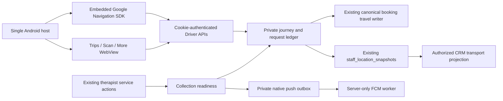

# Driver unified Android candidate — 2026-11-17

**Verdict: CORRECTION REQUIRED.** Local implementation, automated checks and disconnected browser evidence are available. New database contracts have not been executed. Installed Supabase parity, actual Android acceptance, real FCM delivery and external review remain release gates. No merge, push, production connection, deployment, staff APK distribution, real push or database mutation occurred.

## Authorization and repository

The owner's attached “CRADLEHUB DRIVER — UNIFIED ANDROID APPLICATION IMPLEMENTATION” brief authorizes D0–D5 implementation on a dedicated stage branch. It expressly requires separate approval before applying new tables, RLS or privileged contracts and separate authorization/external review before main, deployment or staff distribution. The previously confirmed operational policy is that the driver leaves after delivery and returns for therapist collection. Attendance retains the accepted one-scan, maximum 120-minute early-arrival policy; this slice changes no attendance rules or device limits.

- Repository: `https://github.com/techwithmpg/Cradlehub.git`; Web and Android are directories of this same repository.
- Worktree: `E:/cradlehub/.worktrees/driver-unified-android-shell`.
- Branch: `stage/driver-unified-android-shell-20261117`.
- Freshly fetched accepted `origin/main`, local main and merge base: `51ba200580068691a0358323e00c8c4a7a8de11e`.
- Implementation head: `e1bbba4b0258ec1fabf5bab631ea8afa13224666`. The following closeout commit adds this report, governance and a preview README line-ending correction; it does not change implementation behavior. Resolve final branch HEAD using `git rev-parse HEAD`.
- [Implementation changed-file manifest](DRIVER-UNIFIED-ANDROID-CHANGED-FILES-2026-11-17.txt), captured from accepted base to implementation head: 77 files.
- Separate USB-preview worktree `E:/cradlehub-driver-android`, head `c60f5341`, had six local-only changes. It was inspected and preserved; changes were not blindly merged. Only guarded loopback debug capabilities were adapted here. The previous docs-only navigation review worktree/head `09434ffa` is preserved.

## Implemented slices and ownership

| Slice | Candidate implementation | Evidence and remaining gate |
| --- | --- | --- |
| D0 | Verified accepted base, Android/Web ownership, existing standalone navigation, cookie auth, canonical booking writer, location snapshots and notification consumers | Driver baseline reproduced: 114 pass / 1 stale router test fail. Accepted native compile/JVM task passed; there were no baseline native test sources. |
| D1 | Compact Trips; branch/shift/connectivity; explicit loading/error/empty states; four equal Trips / Navigate / Scan / More entries; secondary links retained | Real components rendered with disconnected synthetic fixtures. No horizontal overflow at 320/390/768px. Native host suppresses duplicate Web tabs. Actual target phone remains unspecified. |
| D2 | One `DriverShellActivity` hosts WebView and embedded Google `NavigationFragment`; old native activity becomes a compatibility host; pane switches preserve the same controller/SDK session | Native compile and nine state tests pass. Back uses AndroidX dispatcher for API 36; Pause guidance is explicit. Process recovery refetches server authority and requires explicit Resume if the SDK session is gone. GPS/voice/real lifecycle continuity is not verified. |
| D3 | Separate pickup, delivery, service, collection, return and explicit branch drop-off; CAS revisions and request identities; direct legacy-writer bypass guard; therapist completion supplies readiness | API/policy/helper/UI tests pass with mocks. Exact SQL contract and synthetic integration runner are prepared, not executed. Collection is never inferred from GPS or service completion. |
| D4 | Fresh/accurate native GPS through authenticated existing snapshot infrastructure; separate CRM transport/collection projection; trusted-origin camera grants and cleanup; private session-bound FCM registry and bounded worker | Camera pause and late-stream cleanup tests, mocked FCM acceptance, and revoked-device API tests pass. Real camera decode, permissions, FCM, CRM/backend parity remain unverified. No schedule was installed. |
| D5 | Scoped/broader tests, native debug APK, Web build, type/lint, browser captures, guarded database package and handoff | Automated candidate checks below passed; inherited broad-suite failures, database/device acceptance and external review prevent a PASS verdict. |

The Android client owns presentation, the SDK session and raw observations. It supplies no staff/branch authority. Server authentication derives the active driver. The private journey/event transaction owns transport revisions; the existing canonical `advance_staff_booking_progress` writer still owns delivery travel/arrival. The existing therapist service workflow still owns service start/completion. `staff_location_snapshots` remains the location store; booking/payment/attendance are not replaced. Private native enrollment supplies only an OS-push channel preference; durable in-app notifications remain.



Critical behavior:

- Explicit Start is required. GPS observations must be at most 30 seconds old, within five seconds of server future allowance, accuracy at most 50m, and distance plus accuracy within 100m for arrival. GPS arrival never establishes boarding.
- Pickup arrival → explicit therapist-on-board → customer delivery → therapist service → separate collection readiness → return for therapist → explicit collection → branch return → explicit drop-off.
- `auto_due` service timestamps do not establish readiness; an authorized explicit service-completion acknowledgment can repair readiness. Readiness failure adds a warning without undoing canonical service completion.
- Authenticated actors, branch/current assignment, revisions, request hashes, stage ordering, and a conservative one-occupied-transport policy are enforced in the draft transaction. New pickups are blocked while unresolved service/collection commitments lack a validated dispatch plan. No nearest-first assignment mutation or unsupported capacity guess was introduced.
- Old unenrolled trips already in flight can use their existing delivery route. Enrolled trips cannot fall back to a customer-only route. Assignment/destination changes enter review; there is no silent route substitution.
- Native cookie requests are exact-origin, bounded, no-redirect HTTP. Server cookies can refresh through the same authenticated session. The UA marker changes layout only. There is no arbitrary JavaScript-to-native privileged bridge.
- Scan retains existing server authorization. Native leaving/backgrounding stops acquisition/tracks and invalidates delayed acquisition. Only trusted-origin video capture on the scanner path can obtain a camera grant. No microphone grant.
- Native FCM registration derives current staff/session, supports permission revocation and logout cleanup, and keeps tokens private. The worker uses opaque booking/notification IDs, bounded leases/retries and invalid-token hashes. Native receipt deduplicates notice IDs. Native preference suppresses browser OS push only for covered Driver booking events; other notifications retain their existing path. Provider acceptance is not device delivery.
- The debug LOCAL TEST package uses `.localtest`, only `http://localhost:7100`, and a deliberately invalid Navigation key. Release/pilot origins and signing safeguards are retained. No production configuration was copied into this worktree.

## Verification actually executed

[Condensed retained evidence](DRIVER-UNIFIED-ANDROID-TEST-EVIDENCE-2026-11-17.txt). Full local command output remains in `.tmp/d5-*.log` in this worktree. Node 24.14.0 / pnpm 10.33.2, Next 16.2.4, Java 21 Android Studio runtime, cached Navigation SDK 8.1.0 and Gradle 9.6.0 were used. No dependency/lockfile change. The local-only APK is `native/driver-android/app/build/outputs/apk/debug/app-debug.apk` (SHA256 `712f071f2827f191dc6d8dedf0edf0ef05d153c3dbd9c8bc89d19ff0557d525e`); it uses the isolated loopback test package and is not a staff release.

| Check | Result |
| --- | --- |
| All Driver-focused tests | 19 files / **164 passed** |
| Native state/lifecycle JVM tests | **9 passed**, no failures/errors |
| Offline LOCAL TEST APK | `assembleDebug` passed; final native build 38s; APK not installed or distributed |
| Web production compilation | `next build --webpack` passed; 159 static pages; placeholder-only non-routable backend configuration and Driver flags disabled |
| Final standalone TypeScript | `pnpm type-check` passed |
| Changed TypeScript/runner lint | Zero errors; one pre-existing unused `getStaffBranchName` warning in staff actions. Preview lint warning was corrected. |
| Broad affected regression | 146 files / **1,130 passed, 15 failed**; remaining failures reproduce on accepted source |
| Expanded baseline comparison | Six files / 16 failures reproduced in the docs-only accepted-source review worktree. One obsolete five-tab Driver case was then aligned to the owner's approved four-tab contract, leaving 15 inherited failures. |
| Database execution | **NOT RUN**. `node --check` passes. An unapproved guard-only invocation exits before connecting, as designed. |
| Browser UI | Real candidate components with mocked auth/actions and fetch rejection; synthetic watermark; four equal tabs, pickup/collection/empty/error/More, scanner-unavailable recovery, failed boarding retains stage; 320/390/768px no overflow; no console errors on final preview |
| Production bypass guard | Evaluated disabled under `NODE_ENV=production` with actual `DEV_AUTH_BYPASS=false`, `DEV_ALLOW_ALL_MODULES=false` |
| Final source checks | Accepted base reconciliation, no package/lock/migration history changes, diff whitespace/privacy checks; no activation or production action |

The obsolete pre-existing travel test mocked `refresh` while the accepted component calls `router.push`; it now verifies the internal route opens only after a successful server transition. More-link assertions follow the extracted component. The foundational Driver navigation assertion now checks the expressly approved four labels and canonical destinations. No operational failure was removed merely to make a test pass.

The remaining 15 broad-suite failures are in six unchanged application areas: `service-transition-notification-once`, push service-worker visibility/click scope, N3 popup contracts, generic Staff Scan anchor/source-shape contracts, scanner-shell tests missing a Supabase mock, and cross-role work-notice recipient/destination contracts. Their baseline reproduction is retained in the evidence extract. They are not classified as passing or fixed by this slice.

Reproduction commands (from the implementation worktree):

```powershell
$driverTests = @(Get-ChildItem tests/lib/pwa/driver*.test.ts* | ForEach-Object FullName)
fnm exec --using=24.14.0 node node_modules/vitest/vitest.mjs run @driverTests --maxWorkers=4
fnm exec --using=24.14.0 C:/Users/eleur/AppData/Roaming/npm/pnpm.cmd type-check
$changedTs = @(git diff --name-only 51ba200580068691a0358323e00c8c4a7a8de11e HEAD -- '*.ts' '*.tsx')
fnm exec --using=24.14.0 node node_modules/eslint/bin/eslint.js @changedTs tests/database/driver-unified-local-test.mjs
fnm exec --using=24.14.0 node node_modules/vitest/vitest.mjs run tests/lib/pwa tests/lib/attendance tests/lib/notifications tests/lib/staff-portal tests/lib/home-service tests/components/attendance tests/components/bookings/home-service-driver-surfaces.test.tsx tests/lib/bookings/therapist-service-start-push.test.ts tests/lib/bookings/service-transition-notifications.test.ts tests/lib/bookings/service-transition-notification-once.test.ts --maxWorkers=4
```

Web build configuration used `NEXT_PUBLIC_SUPABASE_URL=https://driver-build.invalid`, both Supabase keys set to `LOCAL_TEST_NOT_A_CREDENTIAL`, all three Driver activation flags `false`, blank FCM account and telemetry disabled, then `fnm exec --using=24.14.0 node node_modules/next/dist/bin/next build --webpack`. Next's production mode disables the repository's development-auth bypass. Never substitute the root worktree's real environment for this verification.

Native build command:

```powershell
$env:JAVA_HOME='C:/Program Files/Android/Android Studio/jbr'
$env:ANDROID_HOME='C:/Users/eleur/AppData/Local/Android/Sdk'
& 'C:/Users/eleur/.gradle/wrapper/dists/gradle-9.6.0-bin/42k10rwplmzkhuboz9kdazi7s/gradle-9.6.0/bin/gradle.bat' -p native/driver-android --offline --no-daemon -PCRADLE_NAVIGATION_API_KEY=LOCAL_TEST_NOT_CONFIGURED -PCRADLE_DRIVER_DEBUG_ORIGIN=http://localhost:7100 -PCRADLE_DRIVER_LOCAL_TEST=true :app:testDebugUnitTest :app:assembleDebug
```

## Visual and Android evidence boundaries

[Reproducible disconnected component harness](../../tests/manual/driver-unified/README.md). These are browser captures of real components, **not Android screenshots**:

| Capture | Demonstrates |
| --- | --- |
| [Trips / therapist pickup](assets/driver-unified-android-20261117/01-trips-pickup.png) | Compact identity, appointment, pickup/customer destination, next action |
| [Collection after service](assets/driver-unified-android-20261117/02-collection.png) | Collection remains visible when the completed service is absent from today's legacy jobs |
| [Unassigned](assets/driver-unified-android-20261117/03-empty.png) | Genuine successful empty presentation |
| [Unavailable](assets/driver-unified-android-20261117/04-error.png) | Error does not become a successful empty queue |
| [More](assets/driver-unified-android-20261117/05-more.png) | Attendance, trip history, notices, profile, Scan, help and logout retained |
| [Scanner recovery](assets/driver-unified-android-20261117/06-scan-unavailable.png) | Browser camera-unavailable recovery; no physical QR or attendance submission |
| [Boarding rejection](assets/driver-unified-android-20261117/07-unconfirmed-boarding.png) | Rejected request leaves boarding unconfirmed |
| [Browser navigation fallback](assets/driver-unified-android-20261117/08-browser-native-required.png) | Explicitly states native guidance needs Android; no illustrative map presented as real guidance |

ADB found no physical device. Existing AVD `Medium_Phone_API_37.0` was attempted read-only/headless without wiping userdata; it failed before boot: userdata needs 12,288MB, but 8,457.95MB was available in its existing directory. No emulator or app installation occurred. No device-specific screen, embedded SDK map, voice, route, arrival, background continuity, notification delivery or camera decode can be certified from JVM tests/browser captures. The invalid-key debug build cannot supply those proofs. The owner's actual driver phone models/versions remain unanswered.

Android API-36 back behavior was checked against [Android's target-16 changes](https://developer.android.com/about/versions/16/behavior-changes-16) and the installed SDK's APIs. Native session enrollment uses the documented [Supabase session identity boundary](https://supabase.com/docs/guides/auth/sessions); synthetic checks will not establish installed Auth parity.

## Database approval package — NOT EXECUTED

- [Exact review SQL](../../supabase/operations/driver-unified-journeys.sql): new private control/journey/event/device/push tables; private actor/project/snapshot/event/readiness functions; narrow authenticated public wrappers; canonical-booking travel guard and readiness/notice triggers; service-only native delivery claim/finish/preference; authorized CRM transport projection. No migration-ledger write, backfill, historical replay, scheduler or automatic activation.
- [Approval manifest](../../tests/database/driver-unified-local-approval.json), SHA256 `36a0345cd7833fb5a8c0d8dca7a6db64773bdff2a4c204fcef6bc8aa1166fc47`. SQL SHA256 `a7cc06bb7c53286381e1e439b5172625079993f1b7168a6f945f84d3585c6eeb`.
- [Synthetic fixture](../../tests/database/driver-unified-fixture.sql) and [guarded runner](../../tests/database/driver-unified-local-test.mjs). They use the exact accepted canonical actor/progress definitions identified in the manifest, plus a minimal synthetic schema/Auth stand-in. No claim of real provider-service RPC, full existing-trigger, Supabase RLS/Auth/PostgREST or production parity.
- Proposed target: **LOCAL TEST**, fixed loopback `127.0.0.1:55439`, PostgreSQL 17.x; verify data-directory suffix `/web-attendance-v2/.tmp/attendance-v2-pgdata` before any creation. The runner creates only `driver_unified_test_<timestamp>`, enables the new control only in that synthetic database, runs scenarios and drops only its own new database. It loads no `.env`, DSN, linked project or remote credentials and creates no cluster roles.
- The separate approval request is pending. The guard-only test exited before connecting. No database is claimed installed, tested or active.
- A subsequent installed Supabase TEST target needs its own identity and approval: prerequisites include current staff/booking/attendance/location/notice fields, existing canonical writers and triggers, Auth sessions including `not_after`, and correct grants/roles. Unknown target is a stop condition. Never bulk-push migrations to satisfy prerequisites.

Only after explicit approval of the unchanged manifest, the prepared local command is:

```powershell
fnm exec --using=24.14.0 node tests/database/driver-unified-local-test.mjs --approved-local-test --approved-manifest-sha256=36a0345cd7833fb5a8c0d8dca7a6db64773bdff2a4c204fcef6bc8aa1166fc47
```

## Outstanding issues and next permitted action

| ID | Severity | Status / required evidence |
| --- | --- | --- |
| DRV-UNI-R1 | P1 | New SQL/CAS/authorization/trigger/session/lease behavior is unexecuted. Obtain separate LOCAL TEST approval, run the guarded package, correct/review failures, then separately prove installed Supabase TEST parity. Keep all application/database controls off until accepted. |
| DRV-UNI-R2 | P1 | Real Android acceptance is unverified. Resolve target phone/Android versions and provide an authorized device/emulator. Test all 20 owner acceptance scenarios against a classified backend with a properly restricted SDK key and Firebase configuration. Do not distribute this debug fixture to staff. |
| DRV-UNI-R3 | P1 | External review has not occurred for this Driver implementation. This is the implementing agent's verification/self-review only. Required external review and owner gates precede any accepted merge or release. |
| DRV-UNI-R4 | P2 | Fifteen inherited broad-suite failures remain. Six-file accepted-source reproduction is retained; obtain scoped remediation rather than silently weakening unrelated security/notification tests. |
| DRV-UNI-R5 | P2 | Dispatch planning is deliberately conservative: one occupied transport and blocked new pickups while unresolved collection commitments lack a proven plan. Return destination is the assigned branch. Multi-therapist capacity/optimized plans and other authorized return destinations are not implemented or advertised as available. |
| DRV-UNI-R6 | P2 | CRM collection GPS is exposed by a separate read-only panel; completed-service transport is not repurposed as an active service on the existing Full Map. Verify end-to-end location freshness/visibility and operational acceptance before enabling. |
| DRV-UNI-R7 | P3 | Existing unused helper lint warning and Gradle-10 deprecation warnings remain. No dependency/AGP upgrade was attempted. |

No P0 was demonstrated by the executed checks; that is not an independent security or production-readiness certification. Notification provider acceptance remains distinct from OS delivery. GPS accuracy is evidence, not tamper-proof proof of physical presence.

Next permitted independent work is review/correction within this branch and preparation of device evidence. Applying any new contract awaits the separate approval above. Physical/live device or installed backend acceptance requires a classified authorized target. There is no authorization to merge main (even locally), push, deploy, install production SQL, change migration history/Cron, activate flags, send real pushes or publish/distribute an APK.

## Rollback

Nothing in this candidate is deployed or activated, so there is no production rollback to perform. The stage branch can remain parked; main stays at the accepted base. For a future approved pilot, use the prior signed application and keep controls off if acceptance fails. Do not disable the unified database guard or restore legacy writers while transport legs are active: first reconcile/park active journeys with dispatch under a separate reviewed plan. Do not delete the event/device/journey audit schema as a generic rollback. A production schema downgrade, data repair or control transition needs its own target-aware approval and external review.
