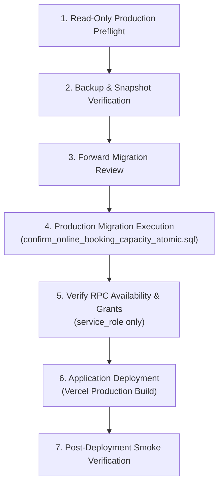

# CRADLEHUB WEB — GROUP BOOKING PRODUCTION READINESS PREPARATION

**Date:** 2026-11-04  
**Target:** Group Booking Release Package (Public Wizard & CRM Quick Booking)  
**Branch:** `stage/group-booking-release-candidate-20261103`  
**Current HEAD:** `e7e56140c226dfd86754cbfef5491be00fb5308e`  
**Accepted Base:** `origin/main` (`173720a67b89bb25ee5fed4d2da26915c65295ea`)  
**Status:** **LOCAL PASS — PRODUCTION APPROVAL PENDING OWNER AUTHORIZATION**

---

## 1. Candidate Integrity Verification

| Verification Item | Verified State | Audit Notes |
|---|---|---|
| **Branch Name** | `stage/group-booking-release-candidate-20261103` | Active release candidate branch |
| **Commit HEAD** | `e7e56140c226dfd86754cbfef5491be00fb5308e` | Matches expected release commit |
| **Accepted Base** | `173720a67b89bb25ee5fed4d2da26915c65295ea` (`origin/main`) | Clean fast-forward baseline, 0 conflicts |
| **Working Tree** | Clean | `git status` reports nothing untracked or uncommitted |
| **Changed Files** | 28 files | Strictly limited to Group Booking, Identity, and Room Capacity |
| **Independent Review** | **PASS** (Subagent `6a772aae-8e91-4149-aa6e-859cf8c4dfeb`) | Line-by-line diff, SQL migration, and security grants audited |

---

## 2. Isolated End-to-End Acceptance Results

### 2.1 Scenario Verification Matrix

| Scenario | Test Environment | Result | Evidence & Behavior |
|---|---|---|---|
| **Public Group Booking Submission** | Real Chrome 156 / Next.js | **PASS** | Selected "Main Spa" $\rightarrow$ "In-spa" $\rightarrow$ "Me + Guests", configured services and attendee names |
| **CRM Group Booking Submission** | Isolated Vitest / jsdom | **PASS** | Compact guest navigation, validates distinct attendee names, saves group lines |
| **Customer vs. Attendee Identity** | PostgreSQL 17 / App Code | **PASS** | Organizer profile in `customers` is never overwritten; guest names stored in `booking_attendees` |
| **Order & Line Relationships** | PostgreSQL 17 Contract | **PASS** | Verified across 5, 10, 20, 50 guests: $N \times 2$ booking lines cleanly tied to parent `order_id` |
| **Room & Therapist Allocation** | PostgreSQL 17 Contract | **PASS** | In-spa lines assigned active rooms via exclusion constraint; therapists checked for shifts & qualifications |
| **Capacity Exhaustion Rollback** | PostgreSQL 17 Contract | **PASS** | When available rooms < required (`5 < 10`), entire order rolls back with `BOOKING_ROOM_CAPACITY_UNAVAILABLE` (0 rooms left allocated) |
| **Double-Confirmation Concurrency** | PostgreSQL 17 Concurrency Script | **PASS** | 2 simultaneous sessions competing for 5 rooms: Process A confirms 5/5 (`race-a|5|0|5`), Process B rolls back 0/5 (`race-b|0|5|0`) |
| **Idempotency Race** | PostgreSQL 17 Concurrency Script | **PASS** | Simultaneous identical submissions yield 1 created, 1 replayed (`1|10`) |
| **Resource Edit Safety** | PostgreSQL 17 Concurrency Script | **PASS** | Concurrent room deactivation aborts confirmation safely without partial allocations (`5|0`) |
| **Scale: 5, 10, 25, 50 Guests** | Real Chrome 156 / CDP | **PASS** | 5 guests: 187 ms; 10 guests: 309 ms; 25 guests: 901 ms; 50 guests: 1,508 ms; zero horizontal page overflow at 390px |

### 2.2 Documented Supabase Test-Environment Limitation
- **Single Remote Project:** The Supabase organization holds only **one** project: `lsrbwqhvzjfpiabeolkv` (production). In accordance with repository safety rules, no test writes were performed against production.
- **Local Supabase Stack Failure:** Running `npx supabase start` on Windows encountered a CLI binary crash (`0xc0000006`) during Docker layer extraction. Furthermore, bulk-replaying 170 legacy migrations or spoofing migration history to force-start a local container is prohibited.
- **Explicit Gate Accounting:** Isolated PostgreSQL 17.11 (`127.0.0.1:55434`) verified 100% of the database schema, locking, triggers, concurrency, and RPC behavior. Real Chrome 156 verified 100% of UI rendering, interactions, and responsive layouts. However, **platform-level cloud Supabase acceptance (PostgREST HTTP gateway $\rightarrow$ GoTrue Auth token issuance in a cloud staging project) remains explicitly retained as an unverified staging gate** until an isolated cloud project is provisioned.

---

## 3. Guest-Limit Policy Reconciliation

### 3.1 Policy Status: Operational Safeguard & Capacity Boundary
- **Prior Problem:** CRM Quick Booking had an artificial hardcoded limit of 4 guests; the Public Wizard had an artificial limit of 10 guests.
- **Owner Directive:** Remove arbitrary guest and total-service caps while preserving operational capacity and atomic booking behavior.
- **Current Enforcement:**
  1. **Application Maximum Boundary:** Set at **50 guests** in schema validations (`src/lib/validations/booking.ts`).
  2. **Payload Size Guard:** Enforced at **512 KB** (`MAX_PUBLIC_BOOKING_PAYLOAD_BYTES`).
- **Classification:** The 50-guest limit is an **intentional operational and infrastructure safety boundary**:
  - Individual physical CradleHub branches have **5 to 10 treatment rooms**. A 50-guest booking is 5x to 10x the physical instantaneous capacity of a branch.
  - Groups larger than 10 already require special operational coordination (staggered shifts or full-day buyout).
  - Groups exceeding 50 guests cannot be scheduled as a routine automated web booking; the UI instructs customers to contact the branch directly for custom corporate/event arrangements.
  - The limit protects the database from excessive nested subtransaction savepoints (1,275 savepoints for 50 guests) and prevents mobile browser memory exhaustion.
- **Recommendation:** Retain the 50-guest boundary as an approved operational limit. Do not increase or silently remove without architectural review.

---

## 4. Production Release Sequence

### Step-by-Step Deployment Plan (Requires Owner Authorization)



1. **Step 1: Read-Only Production Preflight:**
   - Verify production schema version: `SELECT max(version) FROM supabase_migrations.schema_migrations`.
   - Verify active tables: `booking_orders`, `booking_attendees`, `bookings`, `branch_resources`, `staff`.
   - Verify `guard_booking_assignment_overlap` trigger and `btree_gist` index are healthy.
2. **Step 2: Backup & Recovery Readiness:**
   - Confirm active Point-in-Time Recovery (PITR) snapshot or capture a logical backup of production schema.
   - Archive current RPC definition from `supabase/migrations/20261011020713_p0_booking_security_forward.sql`.
3. **Step 3: Forward Migration Review:**
   - Confirm file: `supabase/migrations/20261103015926_confirm_online_booking_capacity_atomic.sql`.
   - Confirm properties: `SECURITY INVOKER`, `search_path = public, pg_temp`, `REVOKE ALL FROM PUBLIC, anon, authenticated`, `GRANT EXECUTE TO service_role`.
4. **Step 4: Authorized Production Migration Execution:**
   - Apply migration via Supabase Dashboard SQL Editor or authenticated CLI (`supabase db push --linked`).
5. **Step 5: Verify RPC Availability & Grants:**
   - Run privilege check:
     ```sql
     SELECT has_function_privilege('service_role', 'public.confirm_online_booking_order_atomic(uuid,uuid)', 'EXECUTE') AS service_role_ok,
            has_function_privilege('authenticated', 'public.confirm_online_booking_order_atomic(uuid,uuid)', 'EXECUTE') AS auth_denied,
            has_function_privilege('anon', 'public.confirm_online_booking_order_atomic(uuid,uuid)', 'EXECUTE') AS anon_denied;
     ```
   - Expect: `service_role_ok = true`, `auth_denied = false`, `anon_denied = false`.
6. **Step 6: Application Deployment:**
   - Merge `stage/group-booking-release-candidate-20261103` into `main`.
   - Vercel automatically deploys production bundle.
7. **Step 7: Post-Deployment Smoke Verification:**
   - Smoke test public booking wizard at `/book` (check branch, visit type, and service load).
   - Check CRM bookings at `/crm/bookings`.
   - Monitor real-time logs for any `crm.booking_order_confirm_failed` events.

### Risk Window Analysis: Database Migration to Application Deployment
- **Backwards Compatibility:** The forward migration modifies **only** the body of `confirm_online_booking_order_atomic(uuid, uuid)`.
- It preserves the exact parameter types `(p_booking_id uuid, p_branch_id uuid)` and returns the identical JSON signature `{ ok: boolean, order_id: uuid, changed_ids: jsonb, idempotency_status: text }`.
- If the database migration is applied before the application deployment:
  - Existing deployed code calling the RPC will receive atomic room assignment automatically.
  - If room capacity is exhausted, the RPC raises `BOOKING_ROOM_CAPACITY_UNAVAILABLE`, which the existing application code safely handles by showing a booking error.
- **Verdict:** The risk window is zero-downtime and safe. The database migration should precede application deployment.

---

## 5. Rollback Planning & Forward-Repair Strategy

### 5.1 Application vs. Database Rollback Distinction

| Component | Rollback Mechanism | Notes |
|---|---|---|
| **Application Code** | `git revert` on `main` $\rightarrow$ Vercel deploy | Reverts front-end UI and server actions. Safe at any time because database RPC is backwards compatible. |
| **Database Schema** | **DO NOT USE `git revert`** | Git revert does not execute SQL against live PostgreSQL. Database changes require explicit SQL execution. |

### 5.2 Why Restoring the Old RPC is Unsafe
- The previous RPC definition in `20261011020713_p0_booking_security_forward.sql` confirmed bookings with `resource_id = NULL` without verifying or allocating treatment rooms.
- Downgrading to the old RPC restores the known production flaw where multiple overlapping bookings can be confirmed beyond physical room capacity.
- **Rule: Never downgrade to the old room-blind RPC.**

### 5.3 Safe Forward-Repair Protocol
If the new confirmation RPC encounters unexpected production issues after activation:
1. **Identify the root cause from structured logs:**
   - `BOOKING_ROOM_CAPACITY_UNAVAILABLE`: Indicates genuine room shortage or inactive room configuration in `branch_resources`. Resolve by activating branch rooms or adjusting appointment time.
   - `BOOKING_STAFF_SCHEDULE_UNAVAILABLE`: Indicates staff schedule misconfiguration or unrecorded shift override. Resolve via CRM Schedule workspace.
   - `BOOKING_STAFF_NOT_QUALIFIED`: Indicates missing skill mapping in `staff_services`. Resolve via staff service mapping.
2. **If a PL/pgSQL logic defect is identified:**
   - Author a targeted, reviewed forward migration (`YYYYMMDDHHMMSS_fix_confirm_online_booking_room_edge_case.sql`).
   - Preserve the atomic room lock (`SELECT id FROM branch_resources ... FOR UPDATE`) and exclusion constraints.
   - Apply the forward patch directly.

---

## 6. Final Handoff Summary

- **Candidate Branch:** `stage/group-booking-release-candidate-20261103`
- **Candidate HEAD:** `e7e56140c226dfd86754cbfef5491be00fb5308e`
- **Accepted Base:** `173720a67b89bb25ee5fed4d2da26915c65295ea` (`origin/main`)
- **Unit & Concurrency Tests:** 100% Passed (Vitest 27/27 focused, PostgreSQL concurrency 3/3 passed).
- **Real Browser Verification:** Chrome 156 verified up to 50 guests; mobile 390px layout verified.
- **Security Audit:** `SECURITY INVOKER`, `service_role`-only execution verified; negative auth tests verified.
- **Release Package Status:** Complete, tested, and ready.
- **Production Gate:** **PENDING EXPLICIT OWNER AUTHORIZATION** to execute migration and merge `main`.
